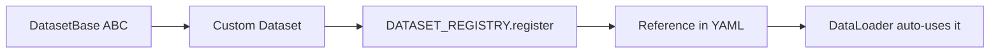

# Custom Datasets

This guide explains how to create and integrate custom datasets into DX-ModelZoo for your specific evaluation needs.

!!! note "Prerequisites"  
    Before creating custom datasets, make sure you have:

    - [Installed DX-ModelZoo](02_01_Installation.md) with development dependencies
    - Basic understanding of Python classes and abstract base classes
    - Familiarity with the [evaluation workflow](02_02_Model_Evaluation.md)

**Overview**  



## DatasetBase Interface

All datasets must inherit from the `DatasetBase` abstract class:

```python
from dx_modelzoo.common.dataloader import DatasetBase

class DatasetBase(ABC):
    def __init__(self, data_dir: str):
        self.data_dir = data_dir
        self._preprocessing = None

    @property
    def preprocessing(self):
        """Preprocessing pipeline (automatically set by the Evaluator)"""
        return self._preprocessing

    @preprocessing.setter
    def preprocessing(self, value):
        self._preprocessing = value

    @abstractmethod
    def __len__(self) -> int:
        """Return the size of the dataset"""
        ...

    @abstractmethod
    def __getitem__(self, idx: int) -> tuple:
        """Return a sample by index"""
        ...

    @abstractmethod
    def validate(self) -> None:
        """Validate dataset files and directory structure"""
        ...
```

## Evaluator Compatibility

The return format of `__getitem__` must match the Evaluator's `extract_inputs` method:

| Evaluator (registry key) | Return Format | Description |
|-----------|---------------|-------------|
| `image_classification` | `(image, label)` | label: int |
| `object_detection` | `(image, origin_shape, image_id)` | Dataset must also expose `coco_annotation` and `remap_class_id()` |
| `instance_segmentation` | `(image, origin_shape, image_id)` | Same contract as `object_detection` |
| `semantic_segmentation` | `(image, mask)` | mask: np.ndarray |
| `depth_estimation` | `(image, depth_map)` | depth_map: np.ndarray |
| `face_detection` | `(image, boxes)` | boxes: np.ndarray |

!!! note "Compatibility with Built-in Evaluators"
    To use a built-in Evaluator, your dataset's return format must match exactly what that Evaluator's `extract_inputs` expects.

!!! warning "There is no `coco` or `segmentation` evaluator key"  
    Registry keys are exact. Use `object_detection` for COCO-style detection and
    `semantic_segmentation` for segmentation. Run `dxmz list` / check
    `src/dx_modelzoo/evaluator/` for the full set of registered keys; an unknown
    key fails at build time.

---

## Implementation

### Creating a Custom Dataset Class

Create a new Python file in the `src/dx_modelzoo/dataset/` directory:

```python title="src/dx_modelzoo/dataset/my_dataset.py"
import os
from pathlib import Path

import cv2
import numpy as np

from dx_modelzoo.common.dataloader import DatasetBase
from dx_modelzoo.dataset import DATASET_REGISTRY


@DATASET_REGISTRY.register("my_custom_dataset")
class MyCustomDataset(DatasetBase):
    """Custom image classification dataset

    Directory structure:
        data_dir/
        ├── images/
        │   ├── 00001.jpg
        │   └── ...
        └── labels.txt        # "filename label" format
    """

    def __init__(self, data_dir: str):
        super().__init__(data_dir)
        self._samples = self._load_annotations()

    def validate(self) -> None:
        self.ensure_exists(
            self.data_dir,
            "Create the dataset directory and provide labels.txt before evaluation.",
        )
        label_file = Path(self.data_dir) / "labels.txt"
        if not label_file.is_file():
            raise FileNotFoundError(f"Missing annotation file: {label_file}")

    def _load_annotations(self) -> list[tuple[str, int]]:
        """Parse the annotation file and return a list of (image_path, label) tuples"""
        label_file = Path(self.data_dir) / "labels.txt"
        samples = []
        with label_file.open("r", encoding="utf-8") as f:
            for line in f:
                filename, label = line.strip().split()
                img_path = os.path.join(self.data_dir, "images", filename)
                samples.append((img_path, int(label)))
        return samples

    def __len__(self) -> int:
        return len(self._samples)

    def __getitem__(self, idx: int) -> tuple:
        img_path, label = self._samples[idx]

        # Load image (BGR format)
        img = cv2.imread(img_path)

        # Apply preprocessing (pipeline set by the Evaluator)
        if self._preprocessing is not None:
            img = self._preprocessing(img)

        return img, label
```

!!! note "Where to Apply `preprocessing`"  
    `self.preprocessing` is automatically configured by the Evaluator via `set_preprocessing()`. The standard pattern is to apply it in `__getitem__` after loading the image.

## Registration

Dataset modules are imported from `src/dx_modelzoo/dataset/__init__.py` to
trigger registry registration. Add an import for the new module there; placing a file in the directory alone does not register it.

### Reference in YAML

```yaml title="MyModel.yaml"
dataset:
  type: my_custom_dataset       # must match the register() name
  eval_path: ${DATA_ROOT}/my_data
```

### Running Evaluation

```bash
dxmz eval MyModel --profile onnx --data-root /path/to/datasets
```

### Example: Complete Workflow

```bash
# 1. Create dataset structure
mkdir -p /data/my_dataset/images
echo "img001.jpg 0" > /data/my_dataset/labels.txt
echo "img002.jpg 1" >> /data/my_dataset/labels.txt

# 2. Set environment variable
export DATA_ROOT=/data

# 3. Run evaluation
dxmz eval MyModel --profile onnx --data-root /data
```

**What happens:**  

- Step 1. DX-ModelZoo loads your YAML configuration
- Step 2. Finds `dataset.type: my_custom_dataset` in the YAML
- Step 3. Resolves `dataset.type: my_custom_dataset` through `DATASET_REGISTRY`
- Step 4. Instantiates `MyCustomDataset` and runs `validate()`
- Step 5. Creates DataLoader with your dataset
- Step 6. Runs evaluation

## COCO-Format Example

A full example implementing a COCO-format custom dataset:

```python title="src/dx_modelzoo/dataset/my_coco.py"
import json
from pathlib import Path

import cv2
import numpy as np

from dx_modelzoo.common.dataloader import DatasetBase
from dx_modelzoo.dataset import DATASET_REGISTRY


@DATASET_REGISTRY.register("my_coco_format")
class MyCocoDataset(DatasetBase):
    """Custom dataset in COCO JSON format, compatible with `object_detection`"""

    def __init__(self, data_dir: str):
        super().__init__(data_dir)
        self._coco = self._load_annotations()
        self._images = self._coco.dataset["images"]

    def validate(self) -> None:
        self.ensure_exists(
            self.data_dir,
            "Create the dataset directory and provide annotations.json before evaluation.",
        )
        if not (Path(self.data_dir) / "annotations.json").is_file():
            raise FileNotFoundError(f"Missing annotation file: {Path(self.data_dir) / 'annotations.json'}")

    def _load_annotations(self):
        from faster_coco_eval import COCO as COCOApi

        return COCOApi(str(Path(self.data_dir) / "annotations.json"))

    @property
    def coco_annotation(self):
        """Ground truth in COCO API form — required by ObjectDetectionEvaluator."""
        return self._coco

    def remap_class_id(self, model_class_id: int) -> int:
        """Map a model class index to the dataset's category ID."""
        return int(model_class_id)

    def __len__(self) -> int:
        return len(self._images)

    def __getitem__(self, idx: int) -> tuple:
        img_info = self._images[idx]
        img_path = Path(self.data_dir) / img_info["file_name"]
        img = cv2.imread(str(img_path))
        origin_shape = (img.shape[0], img.shape[1])

        if self._preprocessing is not None:
            img = self._preprocessing(img)

        # ObjectDetectionEvaluator expects exactly (image, origin_shape, image_id)
        return img, origin_shape, img_info["id"]
```

```yaml title="Corresponding YAML configuration"
dataset:
  type: my_coco_format
  eval_path: ${DATA_ROOT}/my_coco_data

evaluator:
  type: object_detection
```

!!! warning  
    Returning `(image, annotation)` raises
    `ValueError: not enough values to unpack (expected 3, got 2)` inside the
    evaluator's postprocessing-context builder. `origin_shape` is `(H, W)` of the
    **original** image and is used to map boxes back from model input space.

## DataLoader Integration

Datasets are automatically batched by the `DataLoader`:

```python
from dx_modelzoo.common.dataloader import make_dataloader

dataset = MyCustomDataset("/path/to/data")
loader = make_dataloader(dataset, batch_size=4, shuffle=False, num_workers=4)

for batch in loader:
    images, labels = batch
    # images: np.ndarray (batch_size, ...)
```

!!! warning "NumPy-Based"  
    The DataLoader is implemented in pure Python/NumPy. PyTorch is NOT required for the DataLoader itself, though torchvision is used by the preprocessing pipeline for dx_com fusion compatibility. Ensure that `__getitem__` returns NumPy arrays.

## Troubleshooting

| Item | Check |
|------|-------|
| Does the class inherit from `DatasetBase`? | ✅ |
| Are `__len__` and `__getitem__` implemented? | ✅ |
| Is the class registered with `@DATASET_REGISTRY.register()`? | ✅ |
| Does `__getitem__` apply `self.preprocessing`? | ✅ |
| Does `dataset.type` in YAML match the registered name? | ✅ |
| Is the return format compatible with the Evaluator's `extract_inputs`? | ✅ |
